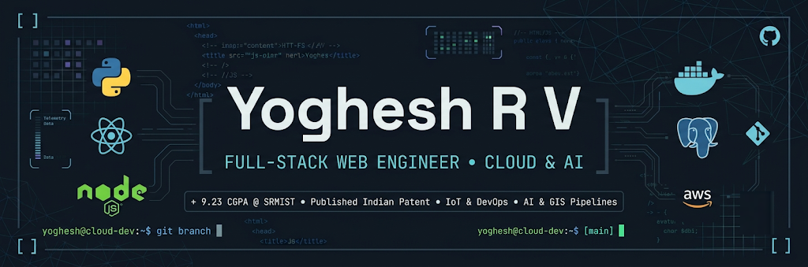
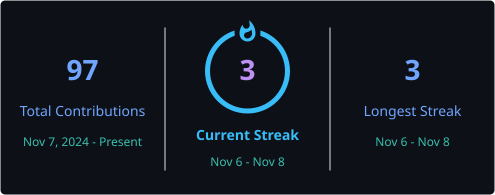

<div align="center">



<br/>


<br/><br/>

<a href="https://yogheshrv.netlify.app/"></a>
<a href="https://github.com/Yoghesh1"></a>
<a href="https://www.linkedin.com/in/yoghesh-r-voltaire-981b40296/"></a>
<a href="mailto:yogheshrv@gmail.com"></a>

</div>

---

## About

I'm Yoghesh, a Computer Science undergraduate specializing in Cloud Computing. I like working across the layers of a product — shaping interfaces, building APIs, modelling data, and connecting services into software that solves a real problem.

My interests sit around **full-stack engineering, cloud platforms, data systems, AI-assisted applications and IoT**. I learn by building: trying an approach, understanding the trade-offs, debugging what breaks, and refining the result. This profile is a collection of the projects, experiments and tools that come out of that process.

---

## Tech Stack

<div align="center">

**Languages**


**Frontend & Mobile**


**Backend & APIs**


**Databases, Cloud & DevOps**


**AI & Computer Vision**


</div>

### Technology & Tools

| Category | Technologies |
|---|---|
| **Programming** | Python, Java, C++, JavaScript, TypeScript, SQL |
| **Frontend & Mobile** | HTML5, CSS3, React.js, Angular, Vite, Tailwind CSS, Bootstrap, React Native, Expo |
| **Backend & APIs** | Node.js, Express.js, FastAPI, Spring Boot, Flask, REST APIs, SQLAlchemy, Prisma |
| **Data Analytics** | Pandas, NumPy, Matplotlib, Seaborn, Tableau, Power BI |
| **Databases & Geospatial** | PostgreSQL, PostGIS, MySQL, SQLite, SQL Server, Firebase |
| **Cloud & DevOps** | AWS, Docker, Kubernetes, Linux, Git, GitHub |
| **AI / ML & Computer Vision** | Generative AI, LLMs, RAG, Ollama, ChromaDB, OpenCV, MediaPipe, LSTM |
| **AI Assistants & Coding Tools** | ChatGPT, Claude, Gemini, GitHub Copilot, OpenAI Codex, Antigravity, Open Code, Kilo Code |
| **Development & API Tools** | VS Code, Postman, Swagger / OpenAPI, npm, pnpm, Firebase Studio |

<sub>Tools are listed from hands-on projects and development workflows we've discussed; familiarity varies by technology.</sub>

---

## Projects & Repositories

A directory of projects, experiments, tools and engineering work. Open-source repositories link directly to their source; private project names are listed here for visibility without exposing their code.

### Applications & Platforms

| Repository | Description |
|---|---|
| [Industrial-ERP-Prototype](https://github.com/Yoghesh1/Industrial-ERP-Prototype) | Industrial ERP and workflow prototype |
| [employeemanagement-cc-26](https://github.com/Yoghesh1/employeemanagement-cc-26) | Employee management application |
| [smart-meal-grocery-platform](https://github.com/Yoghesh1/smart-meal-grocery-platform) | Smart meal planning and grocery platform |
| [health-risk-analyzer-booking-system](https://github.com/Yoghesh1/health-risk-analyzer-booking-system) | Health risk analysis and booking application |
| [smart-infrastructure-planner](https://github.com/Yoghesh1/smart-infrastructure-planner) | Smart infrastructure planning |
| [Unified-Engineering-Workbench](https://github.com/Yoghesh1/Unified-Engineering-Workbench) | Unified engineering workspace |
| [yogheshrv-portfolio](https://github.com/Yoghesh1/yogheshrv-portfolio) | Personal developer portfolio |
| [Yoghesh1](https://github.com/Yoghesh1/Yoghesh1) | GitHub profile README and developer landing page |

### AI, Data & Developer Tools

| Repository | Description |
|---|---|
| [NLQueryEngine](https://github.com/Yoghesh1/NLQueryEngine) | Natural-language-to-SQL analytics engine |
| [local-llm-desktop-assistant](https://github.com/Yoghesh1/local-llm-desktop-assistant) | Desktop assistant using local language models |
| [wind-forecast-evaluation](https://github.com/Yoghesh1/wind-forecast-evaluation) | Wind forecasting and model evaluation |
| [continue](https://github.com/Yoghesh1/continue) | Developer tooling / Continue fork |
| [ToolJet](https://github.com/Yoghesh1/ToolJet) | ToolJet codebase / customization work |

### IoT, Automation & Systems

| Repository | Description |
|---|---|
| [Automatic_Gas_Booking](https://github.com/Yoghesh1/Automatic_Gas_Booking) | IoT-enabled automatic gas booking |
| [Touchless-Gesture-Control](https://github.com/Yoghesh1/Touchless-Gesture-Control) | Gesture-based touchless control |

### Private / Additional Project Work

| Project | Description | Visibility |
|---|---|---|
| Clinic-Operations-EMR | Clinic operations and electronic medical records project | Private |
| Delicious Bites | Bakery website built for Delicious Bites | Private |
| TNPDCL Internship Project | Internship project | Private |
| RETAIL-POS | Point-of-sale and billing software | Private |
| Residential Maintenance, Administration & Automation Platform | Residential maintenance and management platform | Private |

---

## GitHub Analytics

<div align="center">

<!-- GitHub stats and language cards removed because their external image endpoints were not rendering reliably. -->

<br/>



</div>

---

## Contribution Activity

<div align="center">

**Contribution Snake**

<picture>
  <source media="(prefers-color-scheme: dark)" srcset="https://raw.githubusercontent.com/Yoghesh1/Yoghesh1/output/github-contribution-grid-snake-dark.svg"/>
  <source media="(prefers-color-scheme: light)" srcset="https://raw.githubusercontent.com/Yoghesh1/Yoghesh1/output/github-contribution-grid-snake.svg"/>
  
</picture>

<br/><br/>

**Contribution Activity**

<sub>The contribution snake above is generated and refreshed by GitHub Actions.</sub>

</div>

---

## Connect

<div align="center">

<a href="https://yogheshrv.netlify.app/"></a>
<a href="https://www.linkedin.com/in/yoghesh-r-voltaire-981b40296/"></a>
<a href="mailto:yogheshrv@gmail.com"></a>

<br/><br/>

```bash
yoghesh@dev:~$ echo "Thanks for stopping by."
```

**Build • Explore • Iterate**


</div>
